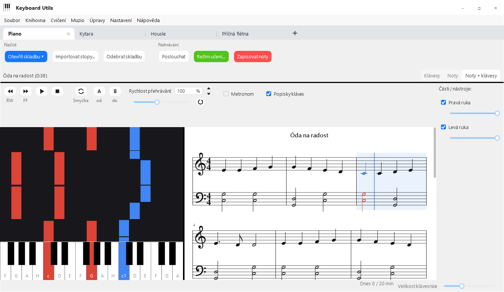
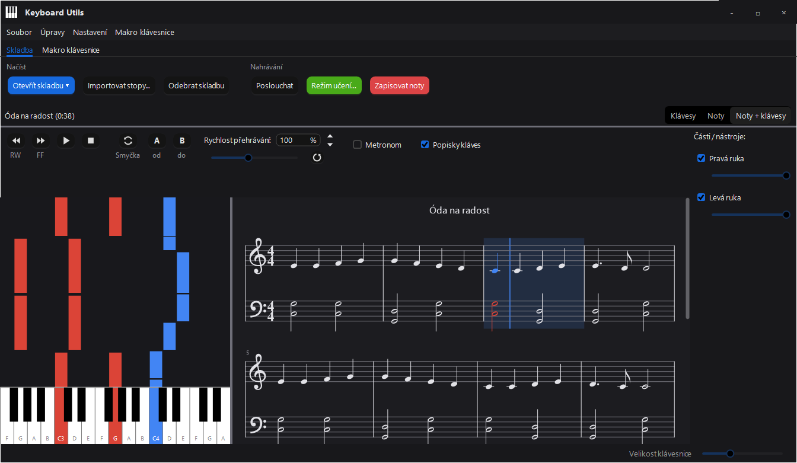

# Keyboard Utils

A helper for playing the keyboard (piano). It loads a song from MIDI or MusicXML (for example an export from
MuseScore), shows it as falling notes (a piano roll) and listens to what you play – through a microphone, MIDI keys,
the computer's sound or by clicking the keyboard in the app. It has a learning mode with scoring, writes down what you
played as MIDI / MusicXML and turns an audio track into notes. Optionally it can be controlled with a second keyboard
(a macro keyboard, e.g. SayoDevice).

| Light mode | Dark mode |
| --- | --- |
|  |  |

## Installation

**Ready-made app:** download [KeyboardUtils.exe](https://github.com/tomandesMSH/Keyboard-Utils/releases/latest/download/KeyboardUtils.exe)
from the latest release and run it – it's a single file, nothing is installed or unpacked. It needs the .NET 10
Desktop Runtime (x64); if it's missing, the app offers a download link on first start. Website:
[tomandesmsh.github.io/Keyboard-Utils](https://tomandesmsh.github.io/Keyboard-Utils/).

From source:

1. Build: `dotnet build -c Release src\KeyboardUtils`
   (the output is in `src\KeyboardUtils\bin\Release\net10.0-windows\win-x64\`).
   Running it needs the .NET 10 Desktop Runtime (x64), Windows 10 or 11.
2. Run `KeyboardUtils.exe`. On first start it asks for the language (čeština / English).
   You can change it later in **Settings > Language**.
3. A single `KeyboardUtils.exe` like the download: `dotnet publish src\KeyboardUtils -c Release -o publish`
   (the libraries and the Interception driver installer with its licence are inside).
4. Tests: `dotnet test tests\KeyboardUtils.Tests` (timing, notes, key signatures, export / import, history,
   macro actions, metronome, updates, exe contents).

**Updates:** on start (at most once a day) the app asks GitHub for the newest version. When there is one, a
**New version ... – update** button appears at the bottom right: it downloads the new `KeyboardUtils.exe`, checks its
size and SHA-256 against GitHub, swaps it for the running exe (which is renamed to `.old`) and restarts the app; the new
version deletes the old file and shows a **What's new** window (also any time via **Help > What's new...**). When the
exe's folder isn't writable, the button just opens the download page. Nothing about you is sent, only the app's name
and version. Turn it off in **Settings > Check for updates**; ask manually with **Settings > Check for updates now**.

The app runs only once – if you start it a second time, the new copy exits straight away. If you don't see the new
version, close all Keyboard Utils windows (or end it in Task Manager).

The macro keyboard is optional and the app needs nothing else to run – see [Macro keyboard](#macro-keyboard).

## Usage

### A song

- **From File Explorer:** on start the app registers itself (just for you, without admin rights) under **Open with**
  for `.mid`, `.midi`, `.musicxml` and `.mxl`. It doesn't change the default program – to open sheet music with a
  double-click, choose **Choose another app > Keyboard Utils > Always**. If the app is already running, the file opens
  in it.
- **Open song...** loads MIDI (`.mid`) or MusicXML (`.musicxml`, `.mxl`). You can pick several files at once and
  switch between them with **Library > Previous song / Next song**.
- **My songs folder** (**Library > My songs folder...**: choose it there) – every MIDI / MusicXML in it (subfolders
  too) is a playlist; the **Play the songs** button loads it and next / previous song moves through it without a dialog.
  **File > Recent songs** shows the last 10 opened.
- **Library** – add the open song to your **favorites** or give it **tags** (separated by commas). The Library then
  has **Favorite songs** and a list of songs for each tag; they open as a playlist. Stored in `config.json`.
- **Find free sheet music...** searches the [Mutopia Project](https://www.mutopiaproject.org/) – over 2000 pieces
  (mostly classical) in the public domain or under Creative Commons licences. The chosen piece is downloaded as MIDI
  and opened; its movements are in the list (**Library > Previous / Next song**). For CC BY licences, credit the
  author and the source when sharing. The app only goes online while you search.
- Controls above the keys / notes: **RW** and **FF** wind while you hold them, faster the longer you hold (2× to 16×;
  FF during playback really speeds the song up, so you hear it), **play / pause**, **stop** and the **Playback speed**
  slider (25–200 %). Sound goes to the MIDI output chosen in **Settings > MIDI output**. That's also where
  **Keyboard Utils piano (better sound)** is – a recording of a real upright piano (FreePats Upright Piano KW, CC0),
  downloaded once (about 45 MB) to `%APPDATA%\KeyboardUtils\modules\piano-sound`. With stems the speed is 100 % only
  (the original recording can't be slowed down).
  The **Key labels** checkbox writes the note name on every white key (otherwise only on C).
- **Metronome** – a click on every beat (the first beat of the bar is accented), following the song's tempo and time
  signature, including tempo changes, slowing down and the loop. Before playback starts it counts in one bar; in
  learning mode in tempo that bar is the lead-in, so you come in on time. Pressing Play again during the count-in
  cancels it. It doesn't work with stems (they're audio recordings; the metronome plays via MIDI).
  When the metronome is ticked, **Without a song** and a tempo in **BPM** appear below it: Play then starts just the
  metronome at that tempo (even with no song open), Stop stops it, and ↑ / ↓ (also from the macro keyboard) change the
  tempo by 5. Below that, **Detect** (or the **T** key, or a macro key) lets you tap the tempo – two taps in time are
  enough; it averages the last four. Next to it choose **2/4, 3/4, 4/4, 5/4 or 6/8**; the first beat is accented,
  in 6/8 it clicks eighths and the BPM is the dotted quarter. The arrow next to Metronome hides the options (the
  metronome stays on).
- **Loop** – repeat a section. Mark it by **dragging across bars in the sheet music**, or during playback with **A**
  (start = now) and **B** (end = now). The **Loop** button turns it on / off. Playback jumps back to the start at the
  end of the section; in **learning mode** you practise just that section and each round starts the next – the
  previous round's result is in the status line. The section is shaded in the sheet music and outlined with a dashed
  line in the falling notes. **Speed up the loop gradually** (in the Learning mode window): each round played at 90 %
  or better makes the next 5 % faster, up to 100 %; the speed reached stays set.
- The **Parts / instruments** panel on the right: a checkbox turns a part off, the slider changes its volume.
- In the piano roll, **drag up / down** to move through the song. A key lights up in its part's colour when the note
  lands. Click a key to play it.
- **Keyboard size** changes the key width – a bigger window shows more octaves, up to the whole keyboard.
- The **Keyboard / Sheet / Sheet + keyboard** switch picks what's shown: falling notes, sheet music (the piano's grand
  staff), or both side by side (the divider can be dragged). In the sheet music the current bar moves along in blue,
  sounding notes have their part's colour and in learning mode turn green / red. Click a bar to move the song there,
  the mouse wheel scrolls the music, **Ctrl + wheel** zooms. The key signature comes from the MusicXML / MIDI file;
  when the file has none (or the MIDI says C major), the app guesses it from the notes. Notes are aligned to
  sixteenths (like the MusicXML export), so fast ornaments or triplets look simplified.
- **Remove song** closes it (the file on disk stays).
- **File > Save song as...** saves the song as MIDI or MusicXML. A song opened from a file keeps its tempo (and its
  changes), time signature and key signature; the MusicXML looks the same as the music in the app.

### Keyboard shortcuts

In the main window (the list is shown by **F1** or **Settings > Keyboard shortcuts...**):

| Key | Action |
| --- | --- |
| Space | play / pause |
| Home | stop (back to the start) |
| ← / → | 5 s back / forward (1 s with Shift) |
| ↑ / ↓ | playback speed +5 % / −5 % |
| R | speed back to 100 % |
| L | loop on / off |
| A / B | loop start / end at the current position |
| M | metronome |
| T | metronome without a song: tap the tempo |
| H | practise the hard spot (loop + learning) |
| K | key labels |
| V | switch the view (keyboard / sheet / both) |
| F5 / F6 / F7 | learning mode / write notes / listen |
| + / − | notes bigger / smaller |
| Page Up / Page Down | previous / next song (with no song open it starts in the songs folder) |
| Ctrl + R | save the recording as MIDI without a dialog (to `Documents\Keyboard Utils\Nahrávky`) |
| Ctrl + O / Ctrl + S | open / save a song |
| Ctrl + D | dark / light mode |
| Ctrl + Z / Ctrl + Y | undo / redo when editing a recording |

While typing in the speed box, keys go to the box.

**Note names:** in **Settings > Note names** choose **school** (c1, f♯2, C, B1 – Czech music-school style, the
default) or **scientific** (C4, F♯5, C2, B0). It applies everywhere: key labels, tuner, fingerings, note-reading
trainer, status line.

### Note input (what the app hears)

In **Settings > Note input** choose where the app gets the played notes from:

- **Microphone (acoustic instrument)** – pitch detection from sound (piano, but also violin, flute, guitar…).
  Before first use open **Settings > Microphone and sensitivity...**, stay quiet for a moment and click **Measure
  noise**, then play a few notes – they should show correctly at the bottom. If the app reacts to noise, move the
  threshold to the right.
- **Computer sound (YouTube, Spotify...)** – listens to what the computer plays (without the app's own sound).
- **Clicking the on-screen keyboard** – a clicked key counts as played. Handy for trying it out without a piano.
- **MIDI: ...** – a digital piano or MIDI keys connected over USB.

The **Listen** button turns listening on – sounding keys light up orange.

### Learning mode

**Learning mode...** – choose which parts you play (e.g. just the right hand), the mode and the speed:

- **Wait for note** – the song stops at the next note until you play it correctly.
- **In tempo** – the song keeps going; a note counts when you play it on time (±0.25 s). The other parts can play as
  accompaniment.

With the microphone or computer sound, **Check every note of a chord** is on: the app knows which notes should sound
and checks each of them in the sound – a chord counts once all of it sounds. If it doesn't hear some note, turn the
option off and one correct note is then enough for a chord.

The keys you should play light up light blue. A correctly played note turns green, a mistake red.
At the end (or after **End learning** / **Stop**) you get a score: the percentage of correct notes, wrong keys,
missed notes and the time, last time's result, the best result and a chart of recent attempts. Every attempt (and
every round of a loop) is saved to the history – **Practice > Practice history...** shows all attempts for the open
song (date, %, speed, mode, parts, section). The history is in `%APPDATA%\KeyboardUtils\history.json`.

**Hard spots:** each attempt records which bars had mistakes. From the last 5 attempts (newer ones count more) the
app picks the worst spots – neighbouring bars are joined, at most 4. The score and the history show "Most mistakes:
bars …", those bars get a red mark with the number of mistakes in the sheet music, and the **Practise bars …** button
(or **H**, or the **Practise the hard spot** macro action) sets a loop on them and starts learning.

**Record my playing** (in the Learning mode window): with the microphone the sound is recorded, with MIDI / clicking
the notes played. The score then has **Listen back** and **Save the recording** (MP3, or WAV / MIDI to
`Documents\Keyboard Utils\Nahrávky`). An audio recording trims the silence at the start and end by itself and is
boosted when you played quietly. Computer sound isn't recorded (it would include the accompaniment).

**Report for the teacher:** **Practice > Report for the teacher (PDF)...** turns the practice history into an
overview of this week, the last 7 / 30 days, this month or any period: minutes and days practised, daily goals met,
a chart of minutes per day and a table of songs (attempts, minutes, best and last result, speed, hard bars), with
room for the teacher's note and signature. It's saved as a PDF to email or print. The name on it is remembered.

**Daily goal and streak:** the bottom right shows how many minutes you practised in learning mode today, and a 🔥
streak of days in a row with the goal met (hover for the last 7 days). Click the indicator to change the goal
(default 20 min, 0 = off). Only learning mode counts, taken from `history.json`.

### Sheet music from Muzio

A task with attached sheet music in [Muzio](https://keyboardheromuzio.vercel.app/) has an **Open in Keyboard
Utils** button. On start the app registers `keyboardutils://` links (just for you, without admin rights); the link
carries a short-lived signed link to the file. The app downloads only MIDI / MusicXML from Muzio's storage
(`*.supabase.co`, https, at most 5 MB) to `%LOCALAPPDATA%\KeyboardUtils\Muzio` and opens it. If it's already running,
a newly started copy hands the file over (a named pipe) and exits. If you don't use Muzio, hide its menu with **Hide the Muzio menu**
in the **Muzio > Muzio...** window (**Settings > Show the Muzio menu** brings it back).

### Scales and warm-ups

**Open song ▾ > Scales and warm-ups...** creates an exercise as a song: a **scale** up and down (harmonic, melodic or
natural minor), a **broken chord**, a **chromatic scale**, a **T–S–D–T cadence**, **chord inversions** or **Hanon
No. 1** (a finger warm-up), in any key (12 major, 10 minor), over 1–2 octaves, for the right, left or both hands, at a
given tempo in quarter or eighth notes. It has bars and a key signature, so learning mode, the speed-up loop, the
metronome and the history all work; save it with Save song as.

### Note-reading trainer

**Practice > Note-reading trainer...** shows a note on the staff; play it (MIDI / microphone / computer sound – both
the key and the octave must match), or click its name or press the letter (C D E F G A H); the **Microphone** checkbox (off by default) turns on answering by playing. Levels: treble clef
(c1–g2), bass (F–c1), both, advanced (ledger lines, sharps and flats) and **intervals** (second–octave, answer with a
button or the digits 2–8). An optional **time limit** of 5 / 3 / 2 s per note. A round has 20 notes; the best result
and the streak of correct answers are remembered. Notes you get wrong come up more often (in later rounds too).

### Instruments other than the piano

**Your instruments are tabs at the top**, like in a browser (e.g. Piano | Guitar | Violin): **+** adds another,
**×** (or the middle mouse button) closes a tab, and you reorder them by dragging. To choose from: piano, guitar,
violin, viola, cello, flute, recorder (soprano), clarinet in B♭, trumpet in B♭, alto saxophone in E♭. Switching the
tab switches the instrument; the song stays open.

**The piano is always in the app; the other instruments are downloadable packs** (3–14 MB) with the instrument's
real sound – recordings from [FreePats](https://freepats.zenvoid.org) and [VSCO 2 Community Edition](https://versilian-studios.com/vsco-community/)
(Versilian Studios), both CC0. A pack is downloaded when you first add the instrument (a tab that still needs it has ⤓
before its name); **Settings > Instruments (download, remove)...** downloads several at once or deletes ones you
don't need. Packs live in `%APPDATA%\KeyboardUtils\instruments` and are hosted in the
[KUtils-Addons](https://github.com/tomandesMSH/KUtils-Addons) repository. For an instrument other than the piano:

- **a fingerboard instead of the keyboard** for the guitar (6 strings, frets 0–12) and the violin, viola and cello
  (4 strings, fingers for 1st position, 0 = open string): it lights up where to play – in the part's colour during
  playback, in learning mode blue for what to play, orange for what the app hears, red for a mistake; rings show the
  notes coming up. **You play it like the instrument:** click a fret / finger place to "press" a string (click again to
  let it go, × releases them all); on the right, on the guitar you **strum** by dragging the mouse across the sound
  hole (a click = one string, a faster drag = louder), on the violin, viola and cello you **bow** along a string (the
  note sounds as long as you drag; a short click = pizzicato). While a song plays the strings move with it – the
  guitar's are plucked, and on violin, viola and cello the string moves for as long as each note lasts;
- for the guitar, **tablature (TAB) under the notes**: fret numbers on six lines showing which string each note is
  played on (top line = the thinnest string). Chord notes go on different strings and the hand stays in its position;
  strings written in a MusicXML file are kept. The fingerboard shows the notes in the same places, and saved MusicXML
  includes the strings and frets. Turn it off in **Settings > Guitar: tablature under the notes**;
- **chord symbols above the notes** (C, Am, G7, F/C…): from MusicXML (`<harmony>`) for any instrument, and for the
  guitar also guessed from the notes when the file has none (per half bar, clear chords only; a melody on its own gets
  none). Click a symbol to see the chord's shape and hear it – with the guitar it's played on the fingerboard. Turn it
  off in **Settings > Chord symbols above the notes**;
- **Practice > Chord library (guitar)...**: the chords a guitarist learns first (C, D, E, F, G, A, Dm, Em, Am, Bm,
  sevenths, maj7, sus) as songbook boxes – finger numbers, × not played, ○ open string. Click one to hear it; with
  the guitar it's pressed and strummed on the fingerboard;
- **fingering charts instead of the keyboard** for the recorder, the flute, the clarinet, the alto saxophone and the trumpet – drawn like the
  instrument (the recorder with its head, window, double holes and the thumb hole at the back, the flute with its keys
  and levers, the trumpet's valves), with hands and fingers labelled: the fingering of the note you play (in learning
  mode, the one to play); above each hole / key is its lane and the song falls down the lanes like the falling
  notes onto the keyboard: when a bar lands on a hole, cover it; when it ends, lift the finger; its length is how long
  to hold, and the names of the notes coming are on the left. **Play them with the mouse:** click to cover holes / press keys (your fingers orange, green where they match
  the note) and hold **Blow** to hear the fingering's note – in learning mode it counts as played; **Harder**
  overblows the flute an octave up and takes the trumpet's next partial. The recorder has baroque and German fingering
  (**Settings > Recorder fingering**); the flute (C4–A6), the clarinet (written E3–C6, the register key above) and
  the saxophone (written B♭3–F6, the octave and palm keys above) use the basic fingerings of the Woodwind Fingering Guide;
- a **Tuner** button right next to Listen / Learning mode;
- **music on a single staff in the instrument's clef** (treble, guitar treble with an 8, alto, bass) and, for
  transposing instruments, as the player reads it – clarinet and trumpet a tone higher, saxophone a sixth, with the key
  signature;
- **the instrument's sound** in playback and when playing the fingerboard – from its pack (violin, viola and cello
  also have pizzicato);
- **the microphone allows for legato and vibrato** (strings and winds) and ignores notes outside the instrument's
  range;
- the **Note-reading trainer** has levels for the instrument (beginning and full range) plus the alto and tenor clefs;
  a played note is judged by how it sounds;
- **Scales and warm-ups**: scale, chromatic scale, broken chord and scale in thirds, single-line from the
  instrument's lowest tonic; the key is chosen as the player reads it;
- saving as MusicXML writes the instrument's part with its clef and transposition; MusicXML with `<transpose>` (e.g. a
  clarinet part from MuseScore) loads correctly.

**Practice > Tuner...** listens to the microphone: the note, a needle ±50 cents (green within ±5), the frequency and,
for transposing instruments, the written note. For string instruments it shows the strings and lights the one you're
tuning; click it to hear it. The a1 reference can be set to 430–446 Hz. Also available as the **Tuner** macro action.

### Writing down notes

**Write notes** – play and the app writes down the notes it recognises. After **Stop recording** the recording opens
as a song: play it back, and if you like it, save it with the **Save** button (it appears next to Write notes) as:

- **MIDI** – exactly what you played,
- **MusicXML** (for MuseScore) – notes aligned to sixteenths, the piano's grand staff. The app asks for the tempo of
  the notation (BPM) – set it roughly to what you played at.

**Editing a recording** (before you save it, in the falling notes): a click selects a note, **Shift + click** adds /
removes another, dragging across empty space selects several. Drag the selected notes with the mouse or move them with
**← / →** (by 20 ms), **↑ / ↓** moves them a semitone, **Delete** deletes them, a double-click opens the exact pitch /
start / length and **Ctrl + Z / Y** undo / redo. Editing ends when you save or open another song.

### Stems and turning audio into notes

**Import stems...** offers two options:

- **As accompaniment** – choose a folder of stems (`.wav`) and the original recording plays; each stem can be turned
  off or down. The **Notes** button on a stem detects its notes and shows them in the piano roll alongside the
  recording – then turn the stem off and play it yourself with the original, in learning mode too.
- **Detect notes from music** – choose an audio file (WAV, MP3, FLAC, AIFF) and the app turns it into notes as a new
  song.

Stems from FL Studio: **Export > WAV File > Miscellaneous > "Split mixer tracks"** exports each mixer track
separately. Links to stems of finished songs are right in the dialog.

### Add-on: chord detection

Without the add-on, turning audio into notes hears one note at a time. An optional add-on – the
[Basic Pitch](https://github.com/spotify/basic-pitch) neural network from Spotify (about 5 MB to download) – also
recognises several notes at once, e.g. piano with chords. The app offers it on the first conversion; if you decline it
won't ask again, and you can download or remove it any time in **Settings > Chord detection (add-on)...**. It's
stored in `%APPDATA%\KeyboardUtils\modules\basic-pitch`.

Build the add-on package with the `tools\pack-basic-pitch-module.ps1` script (output in `artifacts\`).

### Macro keyboard

You can use a second keyboard (SayoDevice, an old keyboard, a numeric keypad...) as a controller for the app.
Its keys don't reach Windows; the main keyboard works normally.

1. **Edit > Macro keyboard... > Set up macro keyboard...** The first time, the app downloads a small add-on module (a
   few tens of KB). If the Interception driver is missing, it offers to **install the driver** (confirm in UAC) and
   then restart the computer. Manual uninstall: `install-interception.exe /uninstall` as administrator, and restart.
2. Press a key on the keyboard you want to use and confirm with **Use this keyboard**.
3. **Add key...**, press a key on the macro keyboard and choose an action. Actions are grouped:
   - **Playback** – play / pause, stop, move by 5 s or 1 s, metronome, volume of all parts.
   - **Loop and speed** – loop (on, start, end), slower / faster / 100 %.
   - **Songs** – next / previous, my songs folder, recent songs, open song.
   - **Learning and recording** – learning mode, and without the settings dialog: wait for note / in tempo, what you
     play (everything / single parts), speed; write notes, save the recording (MIDI without a dialog), listen,
     note input (microphone → computer sound → clicking → MIDI device).
   - **View** – switch the view, notes and keyboard bigger / smaller, key labels, dark mode, window to the front /
     minimise.
   - **Dialogs and windows** – Enter, Esc, Tab, Shift + Tab, arrows and Space: answer any dialog in the app without
     the computer keyboard and mouse (e.g. the learning score: Enter = try again, Esc = close).
   - **Parts of the song** – turn each part off / on and its volume ±10 %.
   - **Note** – play a chosen note.

**Knob** (a rotary knob on the macro keyboard that sends one key over and over as it turns): choose a stepping action
(move, speed, volume, note size, next song, arrows...) and leave **Knob: turn it the other way to set the opposite
direction** ticked – then just turn the knob the other way and the opposite action is assigned by itself. Fast turning
adds up into one step (5 clicks = a 25 s move); when moving through songs, only the one you stop on is loaded.
Toggles (loop, metronome...) switch only once when repeated quickly.

**Big messages:** what a macro key or keyboard shortcut did ("Playback speed: 85 %", "[3/12] Song"...) shows for a
moment in big letters in the middle of the window – readable from the piano. Turn it off in **Settings > Big
messages**.

Save the key assignments to a file with **Export...** and load them with **Import...** (replace the current ones or
add to them). The keyboard choice isn't exported; it applies only to that computer.
**Controls on** temporarily turns capturing off – the macro keyboard then types normally.

**Settings > Dark mode** switches the whole app to dark colours.

Settings are saved to `%APPDATA%\KeyboardUtils\config.json`.

**Help > About** shows the version and links to the source code, the website and the
[documentation](https://tomandesmsh.github.io/Keyboard-Utils/docs/); **Help > Report a bug...** opens
[a form on tomandes.eu](https://tomandes.eu/report/?app=keyboard-utils) with the version filled in – no GitHub account
needed; the report shows up among the [issues](https://github.com/tomandesMSH/Keyboard-Utils/issues).

## Licence

[MIT](LICENSE) © 2026 [tomandesMSH](https://tomandes.eu/). The Interception driver and the chord add-on have their
own licences (see below).

## Notes

- Recognition from sound (microphone, computer sound, converting stems) hears **one note at a time**. It works best on
  the melody or bass of a single instrument; a whole mix doesn't work. Exceptions: learning mode with chord checking
  (the app knows what should sound) and converting files with the chord add-on.
- The lowest notes below F1 (about the bottom 8 keys) aren't recognised from sound. The microphone has a delay of
  about 70 ms – in tempo mode it's subtracted.
- With stems, learning mode in tempo runs only at 100 % – the original recording can't be slowed down.
- Computer sound leaves out the app's own sound only on Windows 10 version 2004 and newer.
- Interception is a kernel-level driver. Anti-cheats like Vanguard (Valorant) or FACEIT may block or flag it.
- Interception has 10 keyboard slots. After many USB unplugs and replugs a new device stops being captured until you
  restart the computer.
- Interception (oblitum) is for non-commercial use under LGPL 3.0, see `tools/`.
- The chord add-on contains Basic Pitch (Spotify, Apache 2.0) and ONNX Runtime (Microsoft, MIT); the licences are
  included in the add-on package.
- The piano sound is the Upright Piano KW SoundFont from [FreePats](http://freepats.zenvoid.org) (CC0, public domain);
  it's played by the [MeltySynth](https://github.com/sinshu/meltysynth) library (MIT).
- Macro keyboard capturing is split into the `src/MacroKeyboard` library, which is shared with
  [Soundpad Translator](https://github.com/tomandesMSH/SoundpadTranslator).
