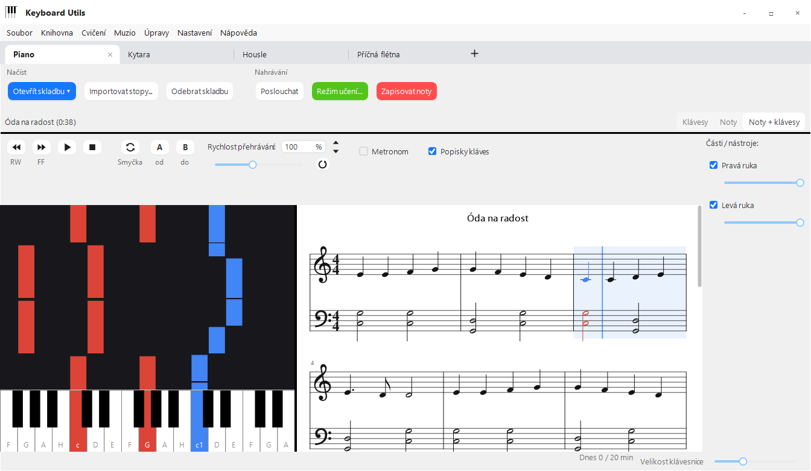
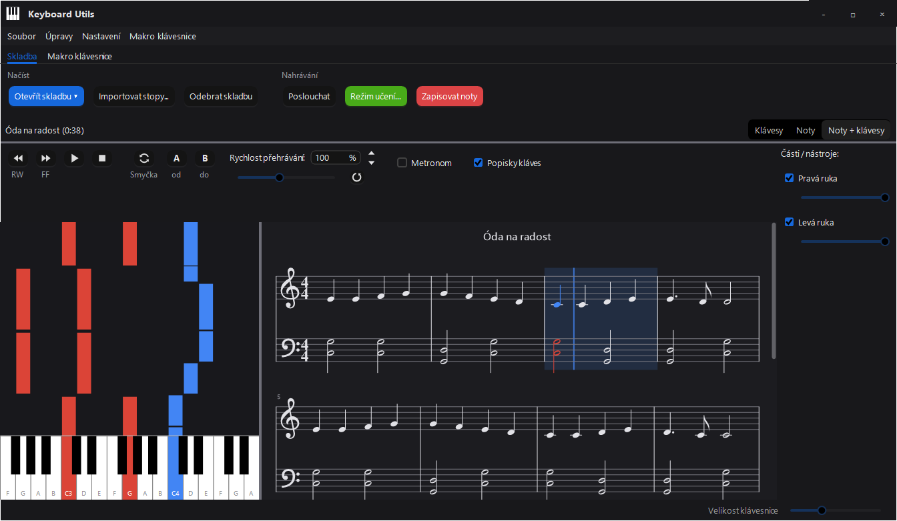

# Keyboard Utils

Pomocník pro hraní na klávesy (piano). Načte skladbu z MIDI nebo MusicXML (třeba export z MuseScore),
ukáže ji jako padající noty (piano roll) a poslouchá, co hraješ – přes mikrofon, MIDI klávesy, zvuk z počítače
nebo klikáním na klaviaturu v appce. Umí režim učení s hodnocením, zápis zahraných not do MIDI / MusicXML
a převod zvukové stopy na noty. Volitelně se dá ovládat druhou klávesnicí (makro klávesnice, např. SayoDevice).

| Světlý režim | Tmavý režim |
| --- | --- |
|  |  |

## Instalace

**Hotová appka:** stáhni [KeyboardUtils.exe](https://github.com/tomandesMSH/Keyboard-Utils/releases/latest/download/KeyboardUtils.exe)
z poslední verze a spusť ho – je to jeden soubor, nic se neinstaluje ani nerozbaluje. Potřebuje .NET 10 Desktop
Runtime (x64); když chybí, appka napoprvé nabídne odkaz ke stažení. Web: [tomandesmsh.github.io/Keyboard-Utils](https://tomandesmsh.github.io/Keyboard-Utils/).

Ze zdrojáků:

1. Sestavení: `dotnet build -c Release src\KeyboardUtils`
   (výstup najdeš v `src\KeyboardUtils\bin\Release\net10.0-windows\win-x64\`).
   Ke spuštění je potřeba .NET 10 Desktop Runtime (x64), Windows 10 nebo 11.
2. Spusť `KeyboardUtils.exe`. Při prvním spuštění se zeptá na jazyk (čeština / English).
   Později ho změníš v **Nastavení > Jazyk**.
3. Jeden `KeyboardUtils.exe` jako ke stažení: `dotnet publish src\KeyboardUtils -c Release -o publish`
   (knihovny i instalátor ovladače Interception s licencí jsou uvnitř).
4. Testy: `dotnet test tests\KeyboardUtils.Tests` (časování, noty, předznamenání, export / import, historie,
   makro akce, metronom, aktualizace, obsah exe).

**Aktualizace:** appka se při spuštění (nejvýš jednou denně) zeptá GitHubu na nejnovější verzi. Když je nová,
objeví se vpravo dole tlačítko **Nová verze ... – aktualizovat**: stáhne nové `KeyboardUtils.exe`, ověří jeho
velikost a SHA-256 podle GitHubu, vymění ho za běžící exe (to se přejmenuje na `.old`) a appku restartuje; nová
verze starý soubor smaže a ukáže okno **Co je nového** (kdykoli i přes **Nápověda > Co je nového...**). Když nejde zapisovat do složky s exe, tlačítko jen otevře stránku ke stažení. Neposílá nic
o tobě, jen název a verzi appky. Vypnout jde v **Nastavení > Kontrolovat aktualizace**, ručně se zeptáš přes
**Nastavení > Zkontrolovat aktualizace teď**.

Aplikace běží jen jednou – když ji spustíš podruhé, nová kopie se hned ukončí. Pokud nevidíš novou verzi,
zavři všechna okna Keyboard Utils (případně ve Správci úloh).

Makro klávesnice je volitelná a nic dalšího k běhu aplikace nepotřebuje – viz [Makro klávesnice](#makro-klávesnice).

## Použití

### Skladba

- **Z Průzkumníka:** při spuštění se appka zaregistruje (jen pro tebe, bez práv správce) do **Otevřít v programu**
  pro `.mid`, `.midi`, `.musicxml` a `.mxl`. Výchozí program nemění – když chceš otevírat noty dvojklikem, vyber
  **Zvolit jinou aplikaci > Keyboard Utils > Vždy**. Když už appka běží, soubor se otevře v ní.
- **Otevřít skladbu...** načte MIDI (`.mid`) nebo MusicXML (`.musicxml`, `.mxl`). Vybrat můžeš víc souborů najednou,
  mezi nimi pak přepínáš v **Knihovna > Předchozí skladba / Další skladba**.
- **Moje složka se skladbami** (**Knihovna > Moje složka se skladbami...**: vybereš ji tam) – všechny MIDI /
  MusicXML v ní (i v podsložkách) jsou playlist; tlačítko **Přehrát skladby** ho načte a další / předchozí
  skladba jím listuje bez dialogu.
  **Soubor > Nedávné skladby** ukáže posledních 10 otevřených.
- **Knihovna** – otevřenou skladbu přidáš do **oblíbených** nebo jí dáš **štítky** (oddělené čárkou).
  V Knihovně pak jsou **Oblíbené skladby** a seznam skladeb pro každý štítek; otevřou se jako playlist.
  Ukládá se do `config.json`.
- **Hledat noty zdarma...** prohledá [Mutopia Project](https://www.mutopiaproject.org/) – přes 2000 skladeb (hlavně
  klasika) jako volné dílo nebo pod licencí Creative Commons. Vybranou skladbu stáhne jako MIDI a otevře; věty
  skladby jsou v seznamu (**Knihovna > Předchozí / Další skladba**). U licencí CC BY uveď při sdílení autora a zdroj.
  Appka se na internet připojí jen ve chvíli, kdy hledáš.
- Ovládání nad klávesami / notami: **RW** a **FF** přetáčí, dokud je držíš, a čím déle, tím rychleji (2× až 16×;
  FF při přehrávání skladbu opravdu zrychlí, takže ji slyšíš), **přehrát / pauza**, **stop** a posuvník **Rychlost přehrávání** (25–200 %). Zvuk jde na MIDI výstup zvolený
  v **Nastavení > MIDI výstup**. Tam je i **Klavír Keyboard Utils (lepší zvuk)** – nahrávka skutečného pianina
(FreePats Upright Piano KW, CC0), stáhne se jednou (asi 45 MB) do `%APPDATA%\KeyboardUtils\modules\piano-sound`.
Se stopami jde rychlost jen 100 % (originální nahrávka zpomalit nejde).
  Zaškrtávátko **Popisky kláves** napíše název noty na každou bílou klávesu (jinak jen na C).
- **Metronom** – klikání na každou dobu (první doba taktu je zvýrazněná), podle tempa a taktu skladby, i při
  změnách tempa, zpomalení a ve smyčce. Před spuštěním přehrávání nejdřív odpočítá jeden takt; v režimu učení
  v tempu je tenhle takt předehrou, takže nastoupíš včas. Opětovným stiskem Přehrát během odpočítávání ho zrušíš.
  Se stopami nejde (jsou to zvukové nahrávky, metronom hraje přes MIDI).
  Když je metronom zaškrtnutý, objeví se pod ním **Bez podkladu** a tempo v **BPM**: Přehrát pak spustí jen
  metronom v tomhle tempu (i bez otevřené skladby), Stop ho zastaví a ↑ / ↓ (i z makro klávesnice) mění tempo o 5.
  Pod tím tlačítkem **Detekce** (nebo klávesou **T**, i makro klávesou) tempo naťukáš – stačí dvě ťuknutí v rytmu, počítá se
  průměr posledních čtyř. Vedle vybereš takt **2/4, 3/4, 4/4, 5/4 nebo 6/8**; první doba taktu je zvýrazněná,
  v 6/8 kliká osminy a BPM je tečkovaná čtvrťová. Šipkou vedle Metronomu volby schováš (metronom zůstane zapnutý).
- **Smyčka** – opakování úseku. Úsek označíš **tažením přes takty v notách**, nebo během přehrávání tlačítky
  **A** (začátek = teď) a **B** (konec = teď). Tlačítkem **Smyčka** ji zapneš / vypneš. Přehrávání se na konci
  úseku vrací na jeho začátek; v **režimu učení** cvičíš jen tenhle úsek a po každém kole začne další – výsledek
  minulého kola je ve stavovém řádku. Úsek je v notách podbarvený a v padajících notách ohraničený čárkovanou čarou.
  **Postupně zrychlovat smyčku** (v okně Režim učení): každé kolo zahrané aspoň na 90 % zrychlí další o 5 %,
  až do 100 %; dosažená rychlost zůstane nastavená.
- Panel **Části / nástroje** vpravo: zaškrtávátkem část vypneš, posuvníkem změníš její hlasitost.
- V piano rollu **tažením nahoru / dolů** posouváš skladbu v čase. Klávesa se při dopadu noty rozsvítí barvou části.
  Kliknutím na klávesu ji zahraješ.
- **Velikost klávesnice** mění šířku kláves – ve větším okně se ukáže víc oktáv, až celá klaviatura.
- Přepínač **Klávesy / Noty / Noty + klávesy** vybere, co se ukáže: padající noty, notový zápis (klavírní dvojosnova),
  nebo obojí vedle sebe (dělítko jde přetáhnout). V notách se modře posouvá aktuální takt, znějící noty mají barvu
  své části a v režimu učení zezelenají / zčervenají. Kliknutím na takt na něj skladbu posuneš, kolečkem myši
  posouváš noty, **Ctrl + kolečko** je zvětší / zmenší. Předznamenání se vezme z MusicXML / MIDI souboru; když
  v souboru není (nebo MIDI uvádí C dur), appka ho odhadne z not. Noty jsou zarovnané na šestnáctiny (stejně jako
  export do MusicXML), takže rychlé ozdoby nebo trioly vypadají zjednodušeně.
- **Odebrat skladbu** ji zavře (soubor na disku zůstane).
- **Soubor > Uložit skladbu jako...** uloží skladbu jako MIDI nebo MusicXML. Skladba otevřená ze souboru si nechá
  své tempo (i jeho změny), takt a předznamenání; MusicXML vypadá stejně jako noty v appce.

### Klávesové zkratky

Na kartě Skladba (seznam ukáže **F1** nebo **Nastavení > Klávesové zkratky...**):

| Klávesa | Akce |
| --- | --- |
| Mezerník | přehrát / pauza |
| Home | zastavit (zpět na začátek) |
| ← / → | o 5 s zpět / dopředu (se Shiftem o 1 s) |
| ↑ / ↓ | rychlost přehrávání +5 % / −5 % |
| R | rychlost zpět na 100 % |
| L | smyčka zapnout / vypnout |
| A / B | začátek / konec smyčky na aktuálním místě |
| M | metronom |
| T | metronom bez podkladu: naťukat tempo |
| H | procvičit těžké místo (smyčka + učení) |
| K | popisky kláves |
| V | přepnout zobrazení (klávesy / noty / obojí) |
| F5 / F6 / F7 | režim učení / zapisovat noty / poslouchat |
| + / − | noty větší / menší |
| Page Up / Page Down | předchozí / další skladba (bez otevřené skladby začne ve složce se skladbami) |
| Ctrl + R | uložit nahrávku jako MIDI bez dialogu (do `Dokumenty\Keyboard Utils\Nahrávky`) |
| Ctrl + O / Ctrl + S | otevřít / uložit skladbu |
| Ctrl + D | tmavý / světlý režim |
| Ctrl + Z / Ctrl + Y | zpět / vpřed při úpravách nahrávky |

Při psaní do políčka rychlosti klávesy patří políčku.

### Vstup not (co appka slyší)

V **Nastavení > Vstup not** vybereš, odkud appka bere zahrané noty:

- **Mikrofon (akustický nástroj)** – rozpoznávání výšky tónu ze zvuku (klavír, ale i housle, flétna, kytara…).
  Před prvním použitím otevři **Nastavení > Mikrofon a citlivost...**, chvíli buď potichu a klikni **Změřit šum**,
  pak zahraj pár not – dole by se měly ukázat správně. Když appka reaguje na šum, posuň práh doprava.
- **Zvuk z počítače (YouTube, Spotify...)** – poslouchá, co hraje počítač (bez zvuku samotné appky).
- **Klikání na klaviaturu v appce** – kliknutá klávesa se počítá jako zahraná. Hodí se na vyzkoušení bez piana.
- **MIDI: ...** – digitální piano nebo MIDI klávesy připojené přes USB.

Tlačítkem **Poslouchat** zapneš poslouchání – znějící klávesy svítí oranžově.

### Režim učení

**Režim učení...** – vybereš, které části hraješ (např. jen pravou ruku), režim a rychlost:

- **Čekat na notu** – skladba se zastaví na další notě, dokud ji nezahraješ správně.
- **V tempu** – skladba jede, nota se počítá, když ji zahraješ včas (±0,25 s). Ostatní části můžou hrát jako doprovod.

S mikrofonem nebo zvukem z počítače je zapnutá volba **U akordů kontrolovat všechny noty**: appka ví, které noty
mají znít, a ve zvuku ověří každou z nich – akord se počítá, až zazní celý. Kdyby některou notu neslyšela, volbu vypni
a u akordu pak stačí jedna správná nota.

Klávesy, které máš zahrát, svítí světle modře. Správně zahraná nota zezelená, chyba zčervená.
Na konci (nebo po **Ukončit učení** / **Stop**) se ukáže hodnocení: procento správných not, špatné klávesy,
vynechané noty a čas, výsledek z minula, nejlepší výsledek a graf posledních pokusů. Každý pokus (i každé kolo
smyčky) se ukládá do historie – **Cvičení > Historie cvičení...** ukáže všechny pokusy u otevřené skladby
(datum, %, rychlost, režim, části, úsek). Historie je v `%APPDATA%\KeyboardUtils\history.json`.

**Těžká místa:** u každého pokusu se ukládá, ve kterých taktech byly chyby. Z posledních 5 pokusů (novější váží víc)
appka vybere nejhorší místa – sousední takty spojí, nejvýš 4. Hodnocení i historie ukážou „Nejvíc chyb: takty …“,
v notách mají ty takty červenou značku s počtem chyb a tlačítko **Procvičit takty …** (nebo **H**, nebo makro akce
**Procvičit těžké místo**) nastaví na ně smyčku a spustí učení.

**Nahrát, jak hraju** (v okně Režim učení): s mikrofonem se nahraje zvuk, s MIDI / klikáním zahrané noty. V hodnocení
je pak **Poslechnout si** a **Uložit nahrávku** (MP3, případně WAV / MIDI do `Dokumenty\Keyboard Utils\Nahrávky`).
Zvuková nahrávka se sama ořízne o ticho na začátku a konci a zesílí, když jsi hrál(a) potichu. Zvuk z počítače
se nenahrává (byl by v něm i doprovod).

**Denní cíl a série:** vpravo dole je vidět, kolik minut jsi dnes cvičil(a) v režimu učení, a 🔥 série dní v řadě
se splněným cílem (najetím myší posledních 7 dní). Cíl (výchozí 20 min, 0 = vypnuto) změníš kliknutím na ukazatel. Počítá se jen režim učení, z `history.json`.

### Noty z Muzia

U úkolu s přiloženými notami v [Muziu](https://keyboardheromuzio.vercel.app/) je tlačítko **Otevřít v Keyboard
Utils**. Appka si při spuštění zaregistruje odkazy `keyboardutils://` (jen pro tebe, bez práv správce); odkaz nese
krátce platný podepsaný odkaz na soubor. Appka stáhne jen MIDI / MusicXML z úložiště Muzia (`*.supabase.co`, https,
nejvýš 5 MB) do `%LOCALAPPDATA%\KeyboardUtils\Muzio` a otevře ho. Když už běží, předá jí ho nově spuštěná kopie
(pojmenovaná roura) a sama skončí.

### Stupnice a rozcvičky

**Otevřít skladbu ▾ > Stupnice a rozcvičky...** vytvoří cvičení jako skladbu: **stupnice** nahoru a dolů (moll
harmonická, melodická nebo přirozená), **rozložený akord**, **chromatická stupnice**, **kadence T–S–D–T**, **obraty
akordu** nebo **Hanon č. 1** (prstová rozcvička), v libovolné tónině (12 dur, 10 moll), na 1–2 oktávy,
pro pravou, levou nebo obě ruce, v zadaném tempu ve čtvrťových nebo osminových notách. Má takty a předznamenání,
takže funguje režim učení, smyčka se zrychlováním, metronom i historie; uložit jde přes Uložit skladbu jako.

### Trénink čtení not

**Cvičení > Trénink čtení not...** ukáže notu na osnově; zahraj ji (MIDI / mikrofon / zvuk z počítače – musí sedět
klávesa i oktáva), nebo klikni na její jméno či zmáčkni písmeno (C D E F G A H). Úrovně: houslový klíč (c1–g2),
basový (F–c1), oba, pokročilý (pomocné linky, křížky a béčka) a **intervaly** (sekunda–oktáva, odpověď tlačítkem
nebo číslicí 2–8). Volitelný **časový limit** 5 / 3 / 2 s na notu. Kolo má 20 not; pamatuje se nejlepší výsledek
a série správných odpovědí. Noty, ve kterých chybuješ, chodí častěji (i v dalších kolech).

### Jiné nástroje než klavír

**Nastavení > Můj nástroj**: klavír, kytara, housle, viola, violoncello, příčná flétna, zobcová flétna (sopránová),
klarinet in B, trubka in B, altový saxofon in Es. Pro jiný nástroj než klavír:

- **noty na jedné osnově v klíči nástroje** (houslový, kytarový s osmičkou, altový, basový) a u transponujících
  nástrojů tak, jak je hráč čte – klarinet a trubka o tón výš, saxofon o sextu, i s předznamenáním;
- **zvuk nástroje** při přehrávání (General MIDI ve Windows; zvukový balíček klavíru hraje jen klavír);
- **mikrofon počítá s legatem a vibratem** (smyčcové a dechové nástroje) a ignoruje tóny mimo rozsah nástroje;
- **Trénink čtení not** má úrovně pro nástroj (začátek a celý rozsah) a navíc altový a tenorový klíč; zahraný tón se
  hodnotí podle toho, jak zní;
- **Stupnice a rozcvičky**: stupnice, chromatická stupnice, rozložený akord a stupnice v terciích jednohlasně od
  nejnižší tóniky nástroje; tónina se vybírá tak, jak ji hráč čte;
- uložení jako MusicXML zapíše part nástroje s jeho klíčem a transpozicí; MusicXML s `<transpose>` (třeba part
  klarinetu z MuseScore) se načte správně.

**Cvičení > Ladička...** poslouchá mikrofon: tón, ručička ±50 centů (zeleně do ±5), frekvence, u transponujících
nástrojů i psaná nota. U strunných nástrojů ukáže struny a rozsvítí tu, kterou ladíš; kliknutím na ni zazní. Ladění
a1 jde nastavit 430–446 Hz. Funguje i jako makro akce **Ladička**.

### Zapisování not

**Zapisovat noty** – hraj a appka zapisuje rozpoznané noty. Po **Ukončit nahrávání** se nahrávka otevře jako
skladba: přehraj si ji, a když se ti líbí, ulož ji tlačítkem **Uložit** (objeví se vedle Zapisovat noty) jako:

- **MIDI** – přesně to, co jsi zahrál,
- **MusicXML** (pro MuseScore) – noty zarovnané na šestnáctiny, klavírní dvojosnova. Appka se zeptá na tempo
  zápisu (BPM) – nastav ho zhruba na to, ve kterém jsi hrál.

**Úpravy nahrávky** (než ji uložíš, v padajících notách): klik vybere notu, **Shift + klik** přidá / odebere další,
tažením přes prázdné místo vybereš víc not. Vybrané noty přetáhneš myší nebo posuneš **← / →** (o 20 ms),
**↑ / ↓** je posune o půltón, **Delete** je smaže, dvojklik otevře přesný tón / začátek / délku a **Ctrl + Z / Y**
vrací zpět / vpřed. Po uložení nebo otevření jiné skladby úpravy skončí.

### Stopy a převod zvuku na noty

**Importovat stopy...** nabídne dvě možnosti:

- **Jako doprovod** – vybereš složku se stopami (`.wav`) a přehraje se originální nahrávka; každou stopu jde
  vypnout nebo zeslabit. Tlačítko **Noty** u stopy z ní rozpozná noty a ukáže je v piano rollu souběžně s nahrávkou –
  stopu pak vypneš a hraješ ji sám k originálu, i v režimu učení.
- **Detekovat noty z hudby** – vybereš zvukový soubor (WAV, MP3, FLAC, AIFF) a appka z něj udělá noty
  jako novou skladbu.

Stopy z FL Studia: **Export > WAV File > Miscellaneous > "Split mixer tracks"** vyexportuje každou stopu mixéru
zvlášť. Odkazy, kde sehnat stopy hotových skladeb, jsou přímo v dialogu.

### Doplněk: rozpoznávání akordů

Bez doplňku převod zvuku na noty slyší jednu notu naráz. Volitelný doplněk – neuronová síť
[Basic Pitch](https://github.com/spotify/basic-pitch) od Spotify (asi 5 MB ke stažení) – pozná i víc not najednou,
třeba piano s akordy. Appka ho nabídne při prvním převodu; když odmítneš, už se neptá a doplněk stáhneš nebo
odebereš kdykoli v **Nastavení > Rozpoznávání akordů (doplněk)...**. Ukládá se do
`%APPDATA%\KeyboardUtils\modules\basic-pitch`.

Balíček doplňku sestavíš skriptem `tools\pack-basic-pitch-module.ps1` (výstup v `artifacts\`).

### Makro klávesnice

Druhou klávesnici (SayoDevice, starou klávesnici, numerický blok...) můžeš používat jako ovladač appky.
Klávesy z ní se nedostanou do Windows, hlavní klávesnice funguje normálně.

1. Karta **Makro klávesnice > Nastavit makro klávesnici...** Napoprvé appka stáhne malý doplňkový modul (pár desítek KB).
   Když chybí driver Interception, nabídne **instalaci ovladače** (potvrdíš v UAC) a pak restart počítače.
   Ruční odinstalace: `install-interception.exe /uninstall` jako administrátor a restart.
2. Stiskni klávesu na klávesnici, kterou chceš používat, a potvrď **Použít tuto klávesnici**.
3. **Přidat klávesu...**, stiskni klávesu na makro klávesnici a vyber akci. Akce jsou ve skupinách:
   - **Přehrávání** – přehrát / pauza, stop, posun o 5 s nebo 1 s, metronom, hlasitost všech částí.
   - **Smyčka a rychlost** – smyčka (zapnout, začátek, konec), pomalejší / rychlejší / 100 %.
   - **Skladby** – další / předchozí, moje složka se skladbami, nedávné skladby, otevřít skladbu.
   - **Učení a nahrávání** – režim učení, a bez dialogu nastavení: čekat na notu / v tempu, co hraješ
     (všechno / jednotlivé části), rychlost; zapisovat noty, uložit nahrávku (MIDI bez dialogu), poslouchat,
     vstup not (mikrofon → zvuk z počítače → klikání → MIDI zařízení).
   - **Zobrazení** – přepnout zobrazení, noty a klávesnice větší / menší, popisky kláves, tmavý režim,
     okno do popředí / minimalizovat.
   - **Dialogy a okna** – Enter, Esc, Tab, Shift + Tab, šipky a mezerník: odpovíš na každý dialog appky bez
     počítačové klávesnice a myši (třeba hodnocení učení: Enter = zkusit znovu, Esc = zavřít).
   - **Části skladby** – pro každou část vypnout / zapnout a hlasitost ±10 %.
   - **Nota** – zahrát zvolenou notu.

**Kolečko** (otočné tlačítko na makro klávesnici, které při otáčení posílá jednu klávesu pořád dokola): vyber
krokovou akci (posun, rychlost, hlasitost, velikost not, další skladba, šipky...) a nech zaškrtnuté **Kolečko:
otočením na druhou stranu nastavit opačný směr** – pak stačí kolečkem otočit na druhou stranu a opačná akce se
přiřadí sama. Rychlé otáčení se sečte do jednoho kroku (5 cvaknutí = posun o 25 s), při listování skladbami se
načte až ta, na které se zastavíš. Přepínače (smyčka, metronom...) se při rychlém opakování přepnou jen jednou.

**Velké hlášky:** co makro klávesa nebo klávesová zkratka udělala („Rychlost přehrávání: 85 %“, „[3/12] Skladba“...),
se na chvíli ukáže velkým písmem uprostřed okna – čitelné i od piana. Vypnout jde v **Nastavení > Velké hlášky**.

Přiřazení kláves uložíš do souboru tlačítkem **Exportovat...** a načteš tlačítkem **Importovat...**
(nahradit současné, nebo přidat ke stávajícím). Volba klávesnice se neexportuje, platí jen pro daný počítač.
**Ovládání zapnuté** dočasně vypne zachytávání – makro klávesnice pak píše normálně.

**Nastavení > Tmavý režim** přepne celou appku do tmavých barev.

Nastavení se ukládá do `%APPDATA%\KeyboardUtils\config.json`.

**Nápověda > O aplikaci** ukáže verzi a odkazy na zdrojový kód, web a [dokumentaci](https://tomandesmsh.github.io/Keyboard-Utils/docs/);
**Nápověda > Nahlásit chybu...** otevře [formulář na tomandes.eu](https://tomandes.eu/report/?app=keyboard-utils)
s vyplněnou verzí – GitHub účet není potřeba, hlášení se objeví mezi [issues](https://github.com/tomandesMSH/Keyboard-Utils/issues).

## Licence

[MIT](LICENSE) © 2026 [tomandesMSH](https://tomandes.eu/). Ovladač Interception a doplněk pro akordy mají své vlastní licence (viz níže).

## Poznámky

- Rozpoznávání ze zvuku (mikrofon, zvuk z počítače, převod stop) slyší **jednu notu naráz**. Nejlíp funguje
  melodie nebo basa jednoho nástroje; celý mix skladby nejde. Výjimky: režim učení s kontrolou akordů (appka ví, co
  má znít) a převod souborů s doplňkem pro akordy.
- Nejhlubší noty pod F1 (asi spodních 8 kláves) ze zvuku nerozpozná. Mikrofon má zpoždění kolem 70 ms –
  v režimu v tempu se odečítá.
- Se stopami jede režim učení v tempu jen na 100 % – originální nahrávka zpomalit nejde.
- Zvuk z počítače vynechává zvuk samotné appky jen na Windows 10 verze 2004 a novějších.
- Interception je ovladač na úrovni jádra. Anticheaty jako Vanguard (Valorant) nebo FACEIT ho můžou blokovat
  nebo hlásit.
- Interception má 10 slotů pro klávesnice. Po mnoha odpojeních a připojeních USB přestane nové zařízení
  zachytávat, dokud nerestartuješ počítač.
- Interception (oblitum) je pro nekomerční použití pod LGPL 3.0, viz `tools/`.
- Doplněk pro akordy obsahuje Basic Pitch (Spotify, Apache 2.0) a ONNX Runtime (Microsoft, MIT); licence jsou
  přiložené v balíčku doplňku.
- Zvuk klavíru je SoundFont Upright Piano KW z projektu [FreePats](http://freepats.zenvoid.org) (CC0, public domain);
  přehrává ho knihovna [MeltySynth](https://github.com/sinshu/meltysynth) (MIT).
- Zachytávání makro klávesnice je oddělené do knihovny `src/MacroKeyboard`, kterou sdílí i
  [Soundpad Translator](https://github.com/tomandesMSH/SoundpadTranslator).
